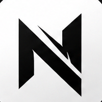
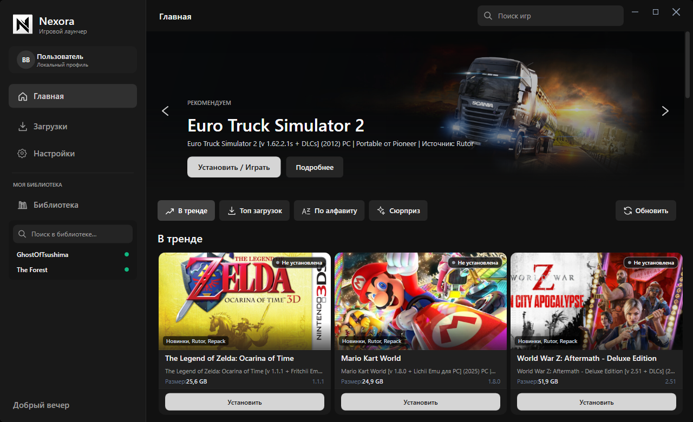
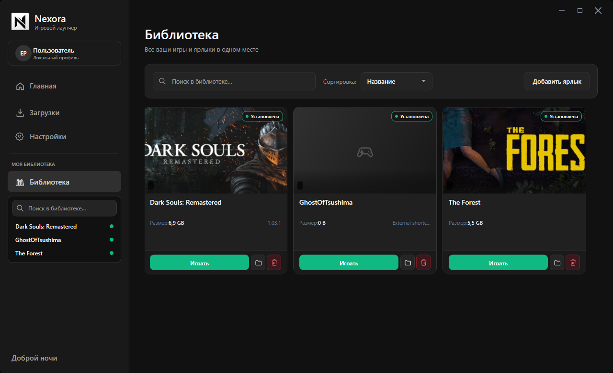
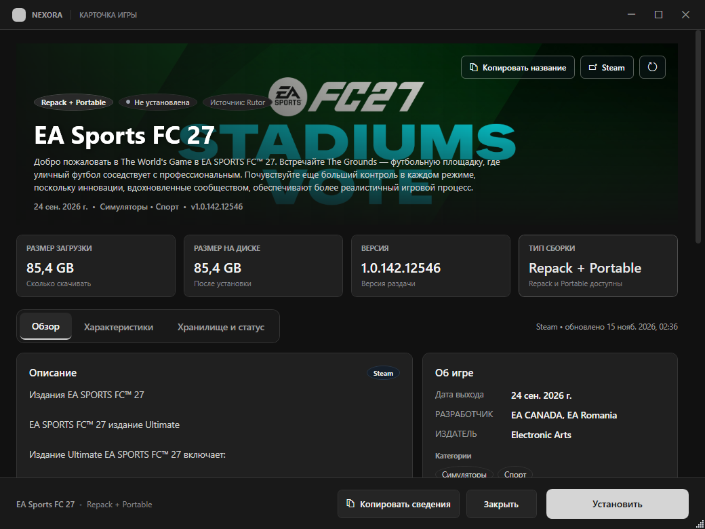

<div align="center">



# 🎮 Nexora

**Игровой лаунчер для Windows: каталог, загрузки и библиотека в одном окне**

[](https://github.com/LDProjectTeam/Nexora/releases/latest)
[](https://github.com/LDProjectTeam/Nexora/releases/latest)
[](https://dotnet.microsoft.com/)
[](LICENSE)
[](https://github.com/LDProjectTeam/Nexora/actions/workflows/ci.yml)

[](website/assets/screens/home.png)
[](website/assets/screens/library.png)
[](website/assets/screens/details.png)

</div>

**RU** [Русский](#русский) | **EN** [English](#english)

---

## Русский

**Лаунчер для Windows, который ведёт игру от поиска в каталоге до кнопки «Играть»**

> Nexora ищет игры в подключённых источниках, качает их через BitTorrent или HTTP с докачкой, проверяет файлы по SHA-256 и собирает установленное в одну библиотеку.

[**⬇️ Скачать**](https://github.com/LDProjectTeam/Nexora/releases/latest) · [**🌐 Сайт**](https://ldprojectteam.github.io/Nexora/) · [**🐛 Сообщить о баге**](https://github.com/LDProjectTeam/Nexora/issues)

### ✨ Возможности

| Функция | Описание |
| --- | --- |
| 🎮 **Каталог игр** | Поиск, подборки «В тренде / Топ загрузок / По алфавиту / Сюрприз», фильтры и обложки из Steam |
| 🔎 **Свои источники** | Встроенный каталог Rutor и подключение JSON-каталогов по ссылке |
| 🧲 **BitTorrent** | Движок rqbit на Rust: magnet-ссылки, `.torrent`, fast resume, лимиты скорости |
| ⬇️ **HTTP / HTTPS** | Докачка через `Range`, временная папка `staging`, idle-timeout |
| 🛡️ **Проверка SHA-256** | Хеши финальных файлов сверяются после распаковки; при несовпадении установка отменяется |
| 🧩 **Атомарная установка** | Обновление не повреждает рабочую копию, если загрузка оборвалась |
| 📚 **Библиотека** | Статусы установки и обновлений, запуск игры, проверка файлов, папка и удаление |
| 🔄 **Версии и обновления** | Выбор подходящего релиза игры и обновление установленной копии |
| 🎨 **Интерфейс** | Тёмная тема, цветовые акценты, языки RU / EN / UK, кэш обложек в WebP |

### 🚀 Установка

1. Открой [**Releases**](https://github.com/LDProjectTeam/Nexora/releases/latest)
2. Скачай `Nexora-Setup-1.0.68-win-x64.exe`
3. Запусти установщик и выбери папку библиотеки при первом старте

Установка идёт в профиль пользователя, права администратора не нужны. `.NET` ставить отдельно не требуется: сборка self-contained.

> Установщик не подписан цифровым сертификатом, поэтому Windows SmartScreen может показать предупреждение об издателе.

### 🔧 Сборка из исходников

Нужны .NET 8 SDK, PowerShell и [Inno Setup 6](https://jrsoftware.org/isinfo.php).

```powershell
dotnet restore Nexora.sln
dotnet build Nexora.sln -c Release
dotnet test tests/Nexora.Tests/Nexora.Tests.csproj -c Release

# запуск собранного лаунчера
.\Run-Launcher.bat

# установщик в artifacts\installer
.\installer\Build-Installer.ps1

# статический сайт в website\dist
.\website\Build-Website.ps1
```

### 🛠 Архитектура

```
Nexora/
├── src/
│   ├── Nexora.Core/          # каталог, загрузчики, установка, проверка файлов
│   └── Nexora.App/           # WPF-интерфейс, view models, темы, локализация
├── sidecar/                  # вспомогательные сервисы
├── tools/bin/                # rqbit.exe и служебные утилиты
├── installer/                # Inno Setup 6 и сборка установщика
├── website/                  # статический сайт и скриншоты
├── docs/                     # добавление игр и оптимизация
└── tests/Nexora.Tests/       # xUnit-тесты
```

### 📚 Документация

- [Как добавить игру в каталог](docs/ADDING_GAMES.md)
- [Оптимизация кэша и обложек](docs/OPTIMIZATION.md)
- [Сборка и публикация сайта](website/README.md)

---

## English

**A Windows launcher that takes a game from catalog search to the Play button**

> Nexora finds games in connected sources, downloads them over BitTorrent or HTTP with resume, verifies files by SHA-256, and keeps everything installed in one library.

[**⬇️ Download**](https://github.com/LDProjectTeam/Nexora/releases/latest) · [**🌐 Website**](https://ldprojectteam.github.io/Nexora/) · [**🐛 Report a Bug**](https://github.com/LDProjectTeam/Nexora/issues)

### ✨ Features

| Feature | Description |
| --- | --- |
| 🎮 **Game catalog** | Search, featured/top/alphabetical/surprise picks, filters, and Steam artwork |
| 🔎 **Custom sources** | Built-in Rutor catalog plus JSON catalogs loaded from a URL |
| 🧲 **BitTorrent** | The rqbit Rust engine: magnet links, `.torrent` files, fast resume, speed limits |
| ⬇️ **HTTP / HTTPS** | `Range` resume, a staging folder, and idle-timeout handling |
| 🛡️ **SHA-256 verification** | Final file hashes are checked after unpacking; a mismatch cancels the install |
| 🧩 **Atomic install** | An interrupted update never damages a working copy |
| 📚 **Library** | Install and update statuses, launch, file checks, folder access, and removal |
| 🔄 **Versions and updates** | Pick the right game release and update an installed copy |
| 🎨 **Interface** | Dark theme, accent colors, RU / EN / UK, WebP artwork cache |

### 🚀 Installation

1. Open [**Releases**](https://github.com/LDProjectTeam/Nexora/releases/latest)
2. Download `Nexora-Setup-1.0.68-win-x64.exe`
3. Run the installer and choose a library folder on first launch

The app installs into your user profile and does not need administrator rights. .NET is included in the self-contained build.

> The installer is not digitally signed, so Windows SmartScreen may show a publisher warning.

### 🔧 Building from Source

You need the .NET 8 SDK, PowerShell, and [Inno Setup 6](https://jrsoftware.org/isinfo.php).

```powershell
dotnet restore Nexora.sln
dotnet build Nexora.sln -c Release
dotnet test tests/Nexora.Tests/Nexora.Tests.csproj -c Release

# run the built launcher
.\Run-Launcher.bat

# installer in artifacts\installer
.\installer\Build-Installer.ps1

# static site in website\dist
.\website\Build-Website.ps1
```

---

## 🛠️ Tech Stack

```
UI:        .NET 8 · WPF · XAML · MVVM
Core:      C# · async I/O · SHA-256
Torrent:   rqbit (Rust) · separate sidecar process
Archives:  SharpCompress · SkiaSharp · HtmlAgilityPack
Installer: Inno Setup 6
CI:        GitHub Actions · xUnit
Website:   HTML · CSS · JavaScript
```

---

## 📜 License / Лицензия

Copyright (c) 2026 **Nexora**. All rights reserved.

This project is proprietary. Copying, modifying, or distributing the code without written permission from the author is prohibited. See [LICENSE](LICENSE) for details.

Данный проект является проприетарным. Копирование, изменение или распространение кода без письменного разрешения автора запрещено. Подробности — в [LICENSE](LICENSE).

---

<div align="center">

Сделано для игроков · Made for players

</div>
